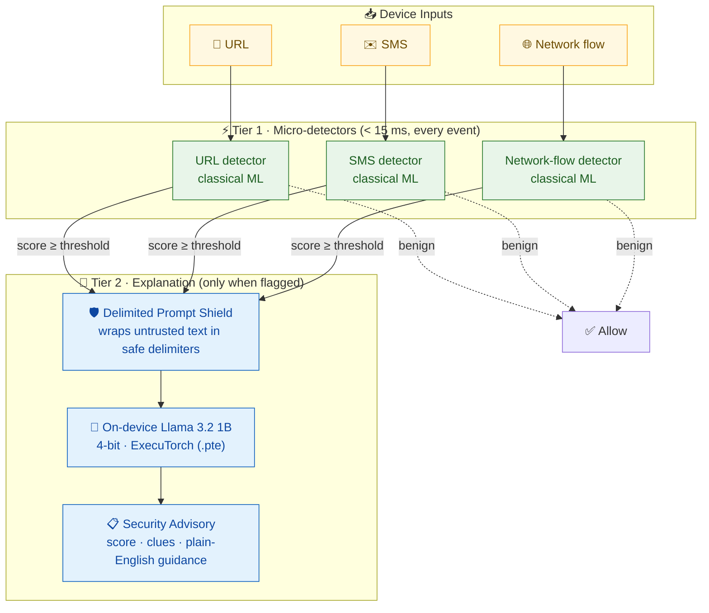

<div align="center">

# 🛡️ SentinelEdge

### On-Device Cyber Threat Detection with a Llama-Based Explainable Assistant

Micro-detectors flag threats in **under 15 ms**. A 4-bit **Llama 3.2 1B** model explains them in plain English.
Everything runs on the phone. **Zero cloud calls. Zero data leaves the device.**

[](https://www.python.org/)
[](#)
[](https://pytorch.org/executorch/)
[](#)
[](#quick-start)

[Why on-device?](#-why-on-device) ·
[Architecture](#-architecture) ·
[Quick start](#-quick-start) ·
[Roadmap](#-roadmap)

</div>

---

## 🎯 Why on-device?

| | ☁️ Cloud-Based Threat Detection | 📱 SentinelEdge On-Device |
|---|---|---|
| **Detection latency** | Network round trip, typically 100s of ms | **< 15 ms** local inference |
| **Privacy** | Raw URLs, SMS and traffic sent to a third party | **Data never leaves the device** |
| **Works offline** | ❌ Fails without signal | ✅ Fully offline / air-gapped |
| **Running cost** | Per-request API or subscription fees | ✅ **Zero** per-request cost |
| **Explanation** | Often a score with no context | ✅ Plain-English advisory from on-device Llama |
| **Attack surface** | Network path and cloud account exposed | ✅ No outbound connection at runtime |
| **Battery & data use** | Constant uploads drain both | ✅ Lightweight local checks only |

---

## 🏗️ Architecture

Two tiers. Tier 1 is fast and cheap and runs on every event. Tier 2 runs only when Tier 1 raises a flag.



**Why the Prompt Shield?** Text from a URL or SMS is attacker-controlled and could try to hijack the language model (prompt injection). The shield places that text inside clearly marked delimiters and treats it as data, never as instructions.

---

## 🖥️ Preview: an intercepted threat advisory

What the user sees when a suspicious SMS is blocked (illustrative mock-up, not yet generated by the app):

```text
┌──────────────────────────────────────────────────────────────────────┐
│ 🛡️  SentinelEdge · Security Advisory                    ⏱ 11.8 ms     │
├──────────────────────────────────────────────────────────────────────┤
│ Source        : SMS from unknown sender                              │
│ Threat score  : 0.94 / 1.00   ████████████████████████████░░  HIGH    │
│ Category      : Phishing (credential harvesting)                     │
│                                                                      │
│ Extracted clues                                                      │
│   • Link domain "secure-acct-verify.co" is 3 days old                │
│   • Urgent wording: "account suspended in 24 hours"                  │
│   • Asks for a one-time PIN, which banks never request               │
│                                                                      │
│ 🦙 Llama guidance (on-device)                                         │
│   This message is trying to scare you into giving away your login.   │
│   Do not tap the link and do not share any codes. If you are worried │
│   about your account, open your bank's app directly and check there. │
│                                                                      │
│ Action: ⛔ Blocked · Logged locally · Nothing sent to the cloud       │
└──────────────────────────────────────────────────────────────────────┘
```

---

## 🚀 Quick start

**Requirements:** Windows 10/11, Python 3.11 or 3.12, Git.

**1. Clone the repository**

```bash
git clone https://github.com/AryaJain781/SentinelEdge.git SentinelEdge
cd SentinelEdge
```

**2. Create and activate a virtual environment**

```bash
py -3.11 -m venv .venv
.venv\Scripts\activate
```

**3. Install pinned dependencies**

```bash
python -m pip install -r requirements.txt
```

**4. Run the quality checks (format → lint → test)**

PowerShell:

```bash
powershell -ExecutionPolicy Bypass -File .\check.ps1
```

Command Prompt:

```bash
check.bat
```

A green `ALL CHECKS PASSED` means the environment is ready.

**5. Build the datasets (Phase 2)**

Download the raw data (HTTPS only, checksums verified), then build the
80/10/10 splits (seed 42, stratified):

```bash
python -m src.utils.download_data
python -m src.utils.data_loader
```

The raw and processed files stay on your computer. Git ignores them.
The NSL-KDD test file is intentionally not downloaded because it was rejected
(see [docs/data_sources.md](docs/data_sources.md)).

> **Windows tip:** if pip reports a "path too long" error, keep the project in a short folder (for example `C:\dev\SentinelEdge`) or enable Windows long paths.

---

## 📁 Repository layout

| Folder | Purpose |
|---|---|
| `src/` | Application code: `detectors/`, `explainer/`, `pipeline/`, `ui/`, `utils/` |
| `data/` | Raw and processed datasets (**never committed**) |
| `models/` | Trained model weights and `.pte` files (**never committed**) |
| `notebooks/` | Exploration notebooks |
| `benchmarks/` | Latency and accuracy benchmark scripts |
| `deploy/` | Android / on-device deployment files |
| `docs/` | Architecture decisions (ADRs), data sources, AI usage log |
| `tests/` | Pytest test suite |

Read [docs/decisions.md](docs/decisions.md) for the reasoning behind each design choice.
Split sizes and class balance are in [docs/data_splits_summary.md](docs/data_splits_summary.md).

---

## 🗺️ Roadmap

Status key: ✅ done · 🔄 in progress · ⏳ planned

| Work Package | Scope | Status |
|---|---|---|
| **WP0** | Project setup: layout, pinned deps, lint/format/test tooling, docs | ✅ Done |
| **WP1** | Dataset selection, licence review and preprocessing pipeline | ✅ Done (Phases 1–2) |
| **WP2** | URL micro-detector (classical ML, < 15 ms) | ✅ Trained (Phase 3), F1 0.85 |
| **WP3** | SMS micro-detector (classical ML, < 15 ms) | ✅ Trained (Phase 3), F1 0.94 |
| **WP4** | Network-flow micro-detector (classical ML, < 15 ms) | ✅ Trained (Phase 3), F1 0.97 (logistic regression) |
| **WP5** | Delimited Prompt Shield for untrusted input | ⏳ Planned |
| **WP6** | Llama 3.2 1B 4-bit export to ExecuTorch (`.pte`) | ⏳ Planned |
| **WP7** | Tier 1 → Tier 2 pipeline and advisory generation | ⏳ Planned |
| **WP8** | Android front end and on-device integration | ⏳ Planned |
| **WP9** | Benchmarks, offline validation, final report and viva material | ⏳ Planned |

---

<div align="center">

**Privacy by design · Speed by architecture · Explanations for humans**

Built as an M.Tech AI engineering project. See [`docs/ai_usage_log.md`](docs/ai_usage_log.md) for AI tool usage.

</div>
